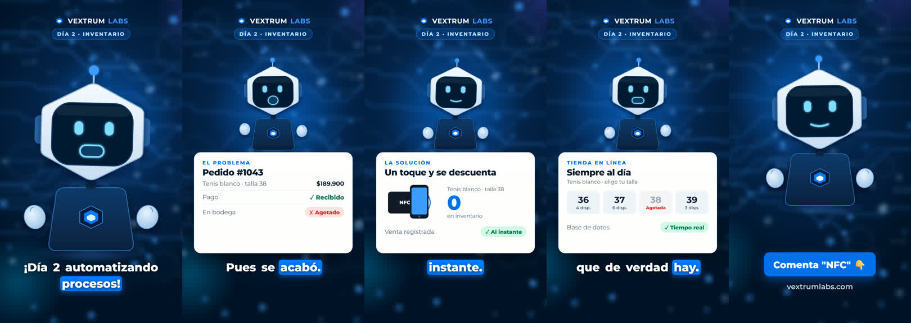

# Vex — AI Brand Avatar Video Pipeline

Turns a short JSON script into a finished vertical video (1080×1920, 30 fps). The output is ready for Instagram Reels or TikTok and includes:

- an animated brand avatar whose mouth is lip-synced to a synthetic voice;
- scene cards that appear exactly when the matching words are spoken;
- word-by-word captions;
- original background music.

I built this pipeline for **Vex**, the avatar of my studio [Vextrum Labs](https://vextrumlabs.com). We also offer it as a service: brands get their own avatar and a series of explainer videos, with no camera and no editing software.



▶️ **Sample output:** [`demo/vex-dia2-inventario.mp4`](demo/vex-dia2-inventario.mp4), a 41 s Spanish video explaining NFC inventory tracking.

## How it works

```
guion.json ──► Edge TTS ──► voice + word timings ──► Rhubarb ──► mouth shapes
                                     │                                 │
                                     └──────────► datos.json ◄─────────┘
                                                  (captions, audio energy, scenes)
                                                       │
avatar.html + scene cards ──► render(t) in Chrome ──► Playwright, 30 fps ──► FFmpeg ──► MP4
                                                                                 ▲
                                                 musica.py ──► music ducked under the voice
```

1. **Script.** `guion.json` lists sections, and each section lists its phrases. Each section becomes a scene.
2. **Voice.** [edge-tts](https://github.com/rany2/edge-tts) synthesizes each phrase (`es-CO-GonzaloNeural`) and returns per-word timestamps. Phrases are joined with controlled pauses.
3. **Lip sync.** [Rhubarb Lip Sync](https://github.com/DanielSWolf/rhubarb-lip-sync) (phonetic recognizer, language-independent) converts the audio into a timeline of 9 mouth shapes.
4. **Alignment.** TTS words are matched back to the script tokens, so captions keep accents and punctuation. Words are grouped into caption lines of up to 4 words, and an RMS envelope of the voice drives the avatar's gestures.
5. **Animation.** The avatar is pure SVG + JavaScript with a deterministic `render(t)` function:
   - the head sways and nods with the voice energy;
   - the eyes blink and look around;
   - the hands gesture and the antenna glows while it speaks;
   - each section's card slides in, and its details appear on keywords (`kw('nfc', 'toque')`).
6. **Capture.** Playwright drives Chrome frame by frame and pipes JPEG frames straight into FFmpeg (H.264, CRF 18).
7. **Audio mix.** `musica.py` generates an original track in NumPy (Am–F–C–G, 110 BPM: pad, arpeggio, bass, drums), so there are no copyright claims. FFmpeg ducks it under the voice with a sidechain compressor and normalizes the mix to −14 LUFS, the level social platforms use.

Rendering a 40 s video takes about 3–4 minutes on a laptop CPU.

## Project structure

| Path | What it is |
|---|---|
| `comun/pipeline.py` | End-to-end build: voice → lip sync → data → HTML → MP4 |
| `comun/voz_vex.py` | Voice synthesis with word timings (optional per-phrase intonation) |
| `comun/base_html.py` | Scene engine: avatar scaling, card transitions, keyword timing |
| `comun/musica.py` | Procedural background music generator |
| `comun/rutas.py` | Locates FFmpeg and Rhubarb (env var → PATH → common install paths) |
| `avatar.html`, `fondo.png` | The Vex avatar (SVG) and background |
| `dia2-inventario/`, `dia3-atencion/`, … | One folder per video: `guion.json` + `armar_html.py` (its scene cards) |

## Run it

Requirements: Python 3.11+, Google Chrome, [FFmpeg](https://ffmpeg.org/), and [Rhubarb Lip Sync](https://github.com/DanielSWolf/rhubarb-lip-sync/releases) (set `FFMPEG` / `RHUBARB` if they are not on your PATH).

```bash
pip install -r requirements.txt
python comun/musica.py                                         # generate the background music once
python comun/pipeline.py dia2-inventario salida/dia2.mp4       # full video
python comun/pipeline.py dia2-inventario - 3,12,20             # preview frames only (PNG in dia2-inventario/tmp)
```

To make a new video, copy an example folder, then edit `guion.json` (the script) and the cards in `armar_html.py`.

## Tools

Python · NumPy · edge-tts · Rhubarb Lip Sync · Playwright · FFmpeg · SVG/JavaScript animation

---
Mateo Gómez Tamayo · [LinkedIn](https://www.linkedin.com/in/mateo-g%C3%B3mez-tamayo) · [GitHub](https://github.com/MateoGomezTamayo) · [Vextrum Labs](https://vextrumlabs.com)

*Font: Montserrat (SIL Open Font License).*
